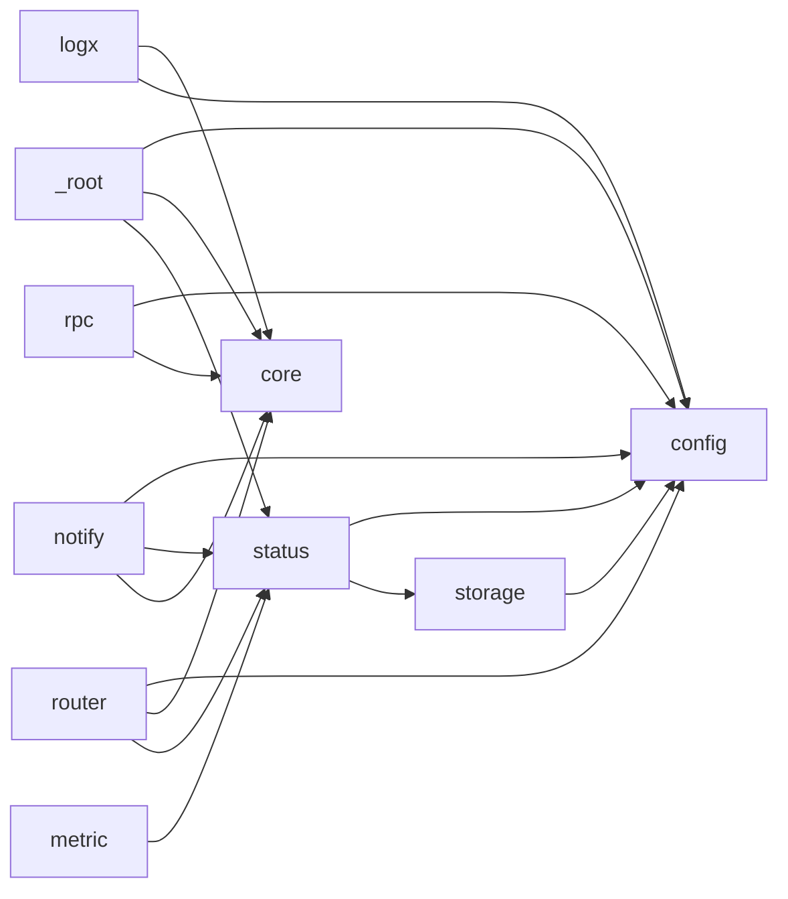

# Dependency Graph

<!-- sdd-knowledge-generated -->

## Feature Dependencies

## External Dependencies

| Package | Import Count |
|---------|--------------|
| `github.com` | 71 |
| `google.golang.org` | 12 |
| `golang.org` | 4 |
| `google-protobuf` | 3 |
| `grpc` | 2 |

## See Also
- [rpc](../features/rpc.md) <!-- rel:strong -->
- [router](../features/router.md) <!-- rel:related -->
- [notify](../features/notify.md) <!-- rel:related -->
- [metric](../features/metric.md) <!-- rel:related -->
- [status](../features/status.md) <!-- rel:related -->
