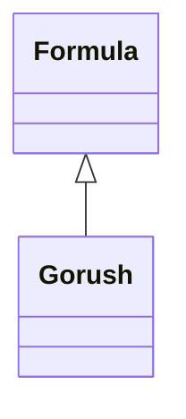

# HomebrewFormula

<!-- sdd-knowledge-generated -->

## Overview

- **Files**: 1
- **Symbols**: 1

## Files

- `HomebrewFormula/gorush.rb` — Gorush

## Class Diagram

## Minimum Viable Specification

> Auto-generated specification for the **HomebrewFormula** feature.

**Key Types**: Gorush

## See Also
- [core](../libs/core.md) <!-- rel:strong -->
- [config](../libs/config.md) <!-- rel:strong -->
- [project structure](../architecture/project-structure.md) <!-- rel:related -->
- [layers](../architecture/layers.md) <!-- rel:weak -->
- [dependency graph](../architecture/dependency-graph.md) <!-- rel:weak -->
