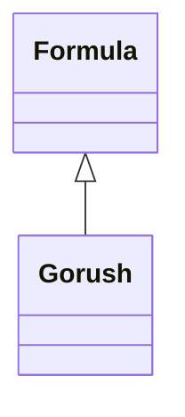

# HomebrewFormula

<!-- sdd-knowledge-generated -->

## Overview

- **Files**: 1
- **Symbols**: 1

## Files

- `HomebrewFormula/gorush.rb` — Gorush

## Class Diagram

## Minimum Viable Specification

> Auto-generated specification for the **HomebrewFormula** feature.

**Key Types**: Gorush

