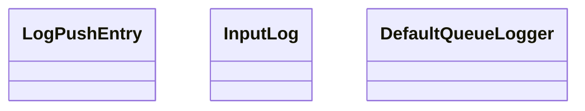

# Logx

<!-- sdd-knowledge-generated -->

## Overview

- **Files**: 3
- **Symbols**: 19
- **DTOs**: colorForPlatForm, typeForPlatForm

## Files

- `logx/log_interface.go` — QueueLogger, DefaultQueueLogger, Infof, Errorf, Fatalf, Info, Error, Fatal
- `logx/log_test.go`
- `logx/log.go` — LogPushEntry, init, InitLog, SetLogOut, SetLogLevel, colorForPlatForm, typeForPlatForm, hideToken, GetLogPushEntry, InputLog, LogPush

## Architecture

### Layers

**Dto**: `colorForPlatForm`, `typeForPlatForm`

**Other**: `LogPushEntry`, `init`, `InitLog`, `SetLogOut`, `SetLogLevel`, `hideToken`, `GetLogPushEntry`, `InputLog`, `LogPush`, `QueueLogger`, `DefaultQueueLogger`, `Infof`, `Errorf`, `Fatalf`, `Info`, `Error`, `Fatal`

## Class Diagram

## External Dependencies

- `github.com`

## Minimum Viable Specification

> Auto-generated specification for the **Logx** feature.

**Contracts**: colorForPlatForm, typeForPlatForm

**Key Types**: LogPushEntry, InputLog, DefaultQueueLogger

## See Also
- [call graph](../architecture/call-graph.md) <!-- rel:strong -->
- [push logging](../observability/push-logging.md) <!-- rel:strong -->
- [config](../libs/config.md) <!-- rel:strong -->
- [core](../libs/core.md) <!-- rel:strong -->
- [dependency graph](../architecture/dependency-graph.md) <!-- rel:related -->
