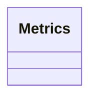

# Metric

<!-- sdd-knowledge-generated -->

## Overview

- **Files**: 2
- **Symbols**: 4

## Files

- `metric/metrics_test.go`
- `metric/metrics.go` — Metrics, NewMetrics, Describe, Collect

## Class Diagram

## External Dependencies

- `github.com`

## Minimum Viable Specification

> Auto-generated specification for the **Metric** feature.

**Key Types**: Metrics

## See Also
- [config](../libs/config.md) <!-- rel:strong -->
- [core](../libs/core.md) <!-- rel:strong -->
- [dependency graph](../architecture/dependency-graph.md) <!-- rel:related -->
- [project structure](../architecture/project-structure.md) <!-- rel:weak -->
- [overview](../architecture/overview.md) <!-- rel:weak -->
