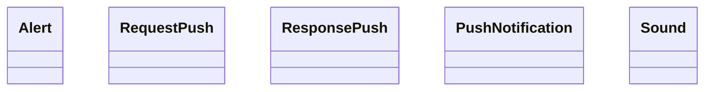

# Notify

<!-- sdd-knowledge-generated -->

## Overview

- **Files**: 12
- **Symbols**: 29
- **DTOs**: CheckMessage

## Files

- `notify/feedback_test.go`
- `notify/feedback.go` — DispatchFeedback
- `notify/global.go`
- `notify/main_test.go`
- `notify/notification_apns_test.go`
- `notify/notification_apns.go` — Sound, InitAPNSClient, newApnsClient, newApnsTokenClient, configureHTTP2ConnHealthCheck, iosAlertDictionary, GetIOSNotification, getApnsClient, PushToIOS
- `notify/notification_fcm_test.go`
- `notify/notification_fcm.go` — InitFCMClient, GetAndroidNotification, PushToAndroid, logPush
- `notify/notification_hms_test.go`
- `notify/notification_hms.go` — GetPushClient, InitHMSClient, GetHuaweiNotification, PushToHuawei
- `notify/notification_test.go`
- `notify/notification.go` — D, Alert, RequestPush, ResponsePush, PushNotification, Bytes, IsTopic, CheckMessage, SetProxy, CheckPushConf, SendNotification

## Architecture

### Layers

**Dto**: `CheckMessage`

**Other**: `DispatchFeedback`, `D`, `Alert`, `RequestPush`, `ResponsePush`, `PushNotification`, `Bytes`, `IsTopic`, `SetProxy`, `CheckPushConf`, `SendNotification`, `Sound`, `InitAPNSClient`, `newApnsClient`, `newApnsTokenClient`, `configureHTTP2ConnHealthCheck`, `iosAlertDictionary`, `GetIOSNotification`, `getApnsClient`, `PushToIOS`, `InitFCMClient`, `GetAndroidNotification`, `PushToAndroid`, `logPush`, `GetPushClient`, `InitHMSClient`, `GetHuaweiNotification`, `PushToHuawei`

## Class Diagram

## External Dependencies

- `github.com`
- `golang.org`

## Minimum Viable Specification

> Auto-generated specification for the **Notify** feature.

**Contracts**: CheckMessage

**Key Types**: Alert, RequestPush, ResponsePush, PushNotification, Sound

## See Also
- [call graph](../architecture/call-graph.md) <!-- rel:strong -->
- [notification dispatch](../architecture/notification-dispatch.md) <!-- rel:strong -->
- [config](../libs/config.md) <!-- rel:related -->
- [dependency graph](../architecture/dependency-graph.md) <!-- rel:related -->
- [core](../libs/core.md) <!-- rel:related -->
