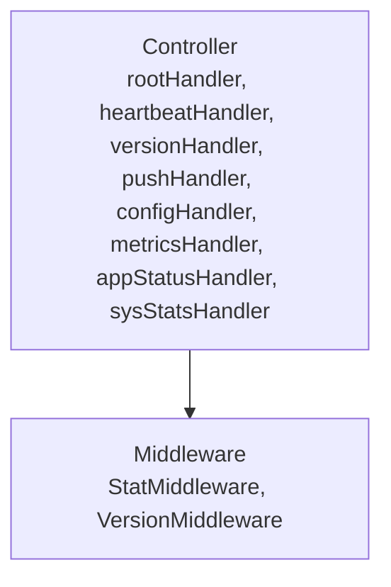

# Router

<!-- sdd-knowledge-generated -->

## Overview

- **Files**: 5
- **Symbols**: 23
- **Controllers**: rootHandler, heartbeatHandler, versionHandler, pushHandler, configHandler, metricsHandler, appStatusHandler, sysStatsHandler

## Files

- `router/server_lambda.go` — RunHTTPServer
- `router/server_normal.go` — RunHTTPServer, listenAndServe, listenAndServeTLS, startServer
- `router/server_test.go`
- `router/server.go` — abortWithError, rootHandler, heartbeatHandler, versionHandler, pushHandler, configHandler, metricsHandler, appStatusHandler, sysStatsHandler, StatMiddleware, autoTLSServer, routerEngine, markFailedNotification, handleNotification
- `router/version.go` — SetVersion, GetVersion, PrintGoRushVersion, VersionMiddleware

## Architecture

### Layers

**Controller**: `rootHandler`, `heartbeatHandler`, `versionHandler`, `pushHandler`, `configHandler`, `metricsHandler`, `appStatusHandler`, `sysStatsHandler`

**Middleware**: `StatMiddleware`, `VersionMiddleware`

**Other**: `abortWithError`, `autoTLSServer`, `routerEngine`, `markFailedNotification`, `handleNotification`, `RunHTTPServer`, `RunHTTPServer`, `listenAndServe`, `listenAndServeTLS`, `startServer`, `SetVersion`, `GetVersion`, `PrintGoRushVersion`

### Data Flow

## External Dependencies

- `github.com`
- `golang.org`

## API Endpoints

| Method | Path | File |
|--------|------|------|
| `GET` | `/version` | `router/server.go` |
| `GET` | `/` | `router/server.go` |

## Minimum Viable Specification

> Auto-generated specification for the **Router** feature.

**API Surface**: 2 endpoint(s)

- `GET /version`
- `GET /`

**Key Types**: none

## See Also
- [call graph](../architecture/call-graph.md) <!-- rel:strong -->
- [api endpoints](../architecture/backend/api-endpoints.md) <!-- rel:related -->
- [overview](../architecture/overview.md) <!-- rel:related -->
- [config](../libs/config.md) <!-- rel:related -->
- [dependency graph](../architecture/dependency-graph.md) <!-- rel:related -->
