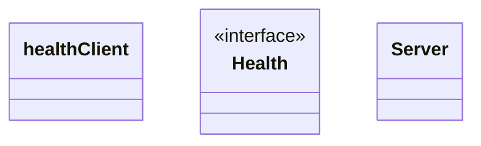
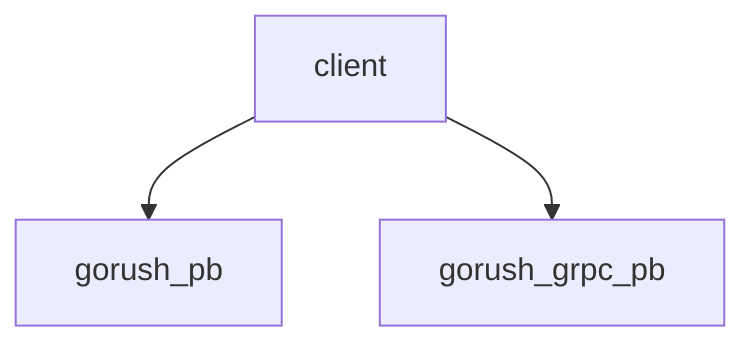

# Rpc

<!-- sdd-knowledge-generated -->

## Overview

- **Files**: 10
- **Symbols**: 21
- **DTOs**: serialize_proto_HealthCheckRequest, deserialize_proto_HealthCheckRequest, serialize_proto_HealthCheckResponse, deserialize_proto_HealthCheckResponse, serialize_proto_NotificationRequest, deserialize_proto_NotificationRequest

## Files

- `rpc/client_grpc_health.go` — healthClient, NewGrpcHealthClient, Close, Check
- `rpc/client_test.go`
- `rpc/example/go/health/main.go` — main
- `rpc/example/go/send/main.go` — main
- `rpc/example/node/client.js` — main
- `rpc/example/node/gorush_grpc_pb.js` — serialize_proto_HealthCheckRequest, deserialize_proto_HealthCheckRequest, serialize_proto_HealthCheckResponse, deserialize_proto_HealthCheckResponse, serialize_proto_NotificationReply, deserialize_proto_NotificationReply, serialize_proto_NotificationRequest, deserialize_proto_NotificationRequest
- `rpc/example/node/gorush_pb.js`
- `rpc/health.go` — Health
- `rpc/server_test.go`
- `rpc/server.go` — Server, NewServer, Check, Send, RunGRPCServer

## Architecture

### Layers

**Dto**: `serialize_proto_HealthCheckRequest`, `deserialize_proto_HealthCheckRequest`, `serialize_proto_HealthCheckResponse`, `deserialize_proto_HealthCheckResponse`, `serialize_proto_NotificationRequest`, `deserialize_proto_NotificationRequest`

**Other**: `healthClient`, `NewGrpcHealthClient`, `Close`, `Check`, `main`, `main`, `main`, `serialize_proto_NotificationReply`, `deserialize_proto_NotificationReply`, `Health`, `Server`, `NewServer`, `Check`, `Send`, `RunGRPCServer`

## Class Diagram

## Internal Dependencies

## External Dependencies

- `github.com`
- `google-protobuf`
- `google.golang.org`
- `grpc`

## Minimum Viable Specification

> Auto-generated specification for the **Rpc** feature.

**Contracts**: serialize_proto_HealthCheckRequest, deserialize_proto_HealthCheckRequest, serialize_proto_HealthCheckResponse, deserialize_proto_HealthCheckResponse, serialize_proto_NotificationRequest, deserialize_proto_NotificationRequest

**Key Types**: healthClient, Health, Server

## See Also
- [dependency graph](../architecture/dependency-graph.md) <!-- rel:strong -->
- [call graph](../architecture/call-graph.md) <!-- rel:strong -->
- [config](../libs/config.md) <!-- rel:strong -->
- [core](../libs/core.md) <!-- rel:related -->
- [grpc interface](../architecture/grpc-interface.md) <!-- rel:related -->
