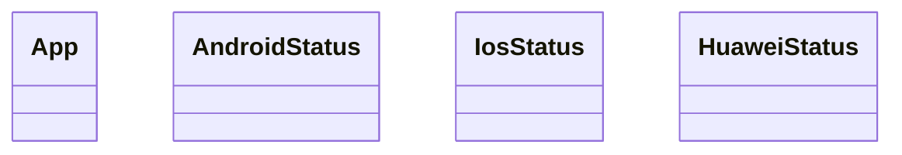

# Status

<!-- sdd-knowledge-generated -->

## Overview

- **Files**: 2
- **Symbols**: 5

## Files

- `status/status_test.go`
- `status/status.go` — App, AndroidStatus, IosStatus, HuaweiStatus, InitAppStatus

## Class Diagram

## External Dependencies

- `github.com`

## Minimum Viable Specification

> Auto-generated specification for the **Status** feature.

**Key Types**: App, AndroidStatus, IosStatus, HuaweiStatus

