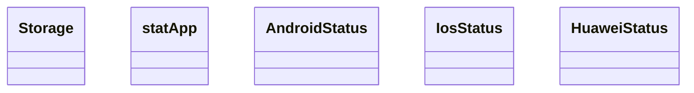
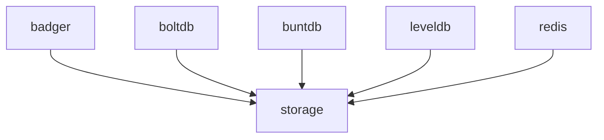

# Storage

<!-- sdd-knowledge-generated -->

## Overview

- **Files**: 13
- **Symbols**: 128

## Files

- `storage/badger/badger_test.go`
- `storage/badger/badger.go` — New, Storage, Init, Close, Reset, setBadger, getBadger, AddTotalCount, AddIosSuccess, AddIosError, AddAndroidSuccess, AddAndroidError, AddHuaweiSuccess, AddHuaweiError, GetTotalCount, GetIosSuccess, GetIosError, GetAndroidSuccess, GetAndroidError, GetHuaweiSuccess, GetHuaweiError
- `storage/boltdb/boltdb_test.go`
- `storage/boltdb/boltdb.go` — New, Storage, Init, Close, Reset, setBoltDB, getBoltDB, AddTotalCount, AddIosSuccess, AddIosError, AddAndroidSuccess, AddAndroidError, AddHuaweiSuccess, AddHuaweiError, GetTotalCount, GetIosSuccess, GetIosError, GetAndroidSuccess, GetAndroidError, GetHuaweiSuccess, GetHuaweiError
- `storage/buntdb/buntdb_test.go`
- `storage/buntdb/buntdb.go` — New, Storage, Init, Close, Reset, setBuntDB, getBuntDB, AddTotalCount, AddIosSuccess, AddIosError, AddAndroidSuccess, AddAndroidError, AddHuaweiSuccess, AddHuaweiError, GetTotalCount, GetIosSuccess, GetIosError, GetAndroidSuccess, GetAndroidError, GetHuaweiSuccess, GetHuaweiError
- `storage/leveldb/leveldb_test.go`
- `storage/leveldb/leveldb.go` — setLevelDB, getLevelDB, New, Storage, Init, Close, Reset, AddTotalCount, AddIosSuccess, AddIosError, AddAndroidSuccess, AddAndroidError, AddHuaweiSuccess, AddHuaweiError, GetTotalCount, GetIosSuccess, GetIosError, GetAndroidSuccess, GetAndroidError, GetHuaweiSuccess, GetHuaweiError
- `storage/memory/memory_test.go`
- `storage/memory/memory.go` — statApp, AndroidStatus, IosStatus, HuaweiStatus, New, Storage, Init, Close, Reset, AddTotalCount, AddIosSuccess, AddIosError, AddAndroidSuccess, AddAndroidError, AddHuaweiSuccess, AddHuaweiError, GetTotalCount, GetIosSuccess, GetIosError, GetAndroidSuccess, GetAndroidError, GetHuaweiSuccess, GetHuaweiError
- `storage/redis/redis_test.go`
- `storage/redis/redis.go` — New, getInt64, Storage, Init, Close, Reset, AddTotalCount, AddIosSuccess, AddIosError, AddAndroidSuccess, AddAndroidError, AddHuaweiSuccess, AddHuaweiError, GetTotalCount, GetIosSuccess, GetIosError, GetAndroidSuccess, GetAndroidError, GetHuaweiSuccess, GetHuaweiError
- `storage/storage.go` — Storage

## Class Diagram

## Internal Dependencies

## External Dependencies

- `github.com`

## Minimum Viable Specification

> Auto-generated specification for the **Storage** feature.

**Key Types**: Storage, Storage, Storage, Storage, statApp, AndroidStatus, IosStatus, HuaweiStatus, Storage, Storage, Storage

## See Also
- [call graph](../architecture/call-graph.md) <!-- rel:strong -->
- [config](../libs/config.md) <!-- rel:related -->
- [models](../architecture/data/models.md) <!-- rel:related -->
- [storage backends](../architecture/storage-backends.md) <!-- rel:weak -->
- [core](../libs/core.md) <!-- rel:weak -->
