# Config

<!-- sdd-knowledge-generated -->

## Overview

- **Files**: 2
- **Symbols**: 20

## Files

- `config/config_test.go`
- `config/config.go` — ConfYaml, SectionCore, SectionAutoTLS, SectionAPI, SectionAndroid, SectionHuawei, SectionIos, SectionLog, SectionStat, SectionQueue, SectionNSQ, SectionNATS, SectionRedis, SectionBoltDB, SectionBuntDB, SectionLevelDB, SectionBadgerDB, SectionPID, SectionGRPC, LoadConf

## Class Diagram

```mermaid
classDiagram
  class ConfYaml {
    <<config>>
  }
  class SectionCore {
    <<config>>
  }
  class SectionAutoTLS {
    <<config>>
  }
  class SectionAPI {
    <<config>>
  }
  class SectionAndroid {
    <<config>>
  }
  class SectionHuawei {
    <<config>>
  }
  class SectionIos {
    <<config>>
  }
  class SectionLog {
    <<config>>
  }
  class SectionStat {
    <<config>>
  }
  class SectionQueue {
    <<config>>
  }
  class SectionNSQ {
    <<config>>
  }
  class SectionNATS {
    <<config>>
  }
  class SectionRedis {
    <<config>>
  }
  class SectionBoltDB {
    <<config>>
  }
  class SectionBuntDB {
    <<config>>
  }
  class SectionLevelDB {
    <<config>>
  }
  class SectionBadgerDB {
    <<config>>
  }
  class SectionPID {
    <<config>>
  }
  class SectionGRPC {
    <<config>>
  }
```

## External Dependencies

- `github.com`

## Minimum Viable Specification

> Auto-generated specification for the **Config** feature.

**Key Types**: ConfYaml, SectionCore, SectionAutoTLS, SectionAPI, SectionAndroid, SectionHuawei, SectionIos, SectionLog, SectionStat, SectionQueue, SectionNSQ, SectionNATS, SectionRedis, SectionBoltDB, SectionBuntDB, SectionLevelDB, SectionBadgerDB, SectionPID, SectionGRPC

## See Also
- [models](../architecture/data/models.md) <!-- rel:strong -->
- [metric](../features/metric.md) <!-- rel:related -->
- [status](../features/status.md) <!-- rel:related -->
- [rpc](../features/rpc.md) <!-- rel:related -->
- [logx](../features/logx.md) <!-- rel:related -->
